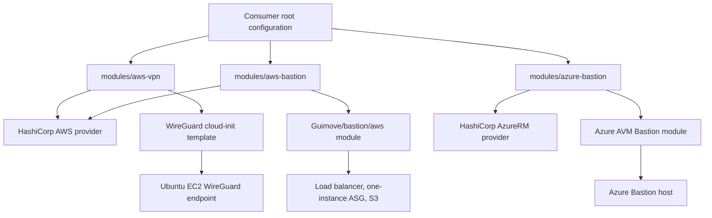
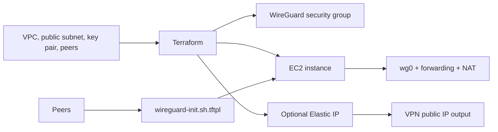

# Project Architecture Blueprint

> Generated 2026-11-08 from the current repository contents. This document describes implemented behavior, not a planned target architecture.

## Overview

This repository is a collection of Terraform modules for personal remote access infrastructure. Its architectural style is **independent infrastructure modules**: each module owns one deployable concern, declares its Terraform/provider compatibility, accepts infrastructure identifiers from a caller, and returns connection-oriented outputs.

The project has no root Terraform configuration, shared module library, application code, CI workflow, or automated test suite. Consumers supply provider authentication and existing network resources from their own root configuration.



## Technology and dependency model

| Area | Implementation |
| --- | --- |
| Infrastructure language | Terraform HCL and `templatefile`-rendered Bash |
| AWS provider constraint | `hashicorp/aws` `>= 4.0, < 6.0` |
| Azure provider constraint | `hashicorp/azurerm` `~> 4.10` |
| Terraform constraint | AWS modules: `>= 1.5`; Azure module: `>= 1.9` |
| External modules | `Guimove/bastion/aws` `~> 3.0`; `Azure/avm-res-network-bastionhost/azurerm` `~> 0.9` |
| Runtime image | Ubuntu 22.04 AMI selected from Canonical when `aws-vpn.ami_id` is unset |

Dependency direction is intentionally one-way: root configurations consume project modules; modules consume providers and selected upstream Registry modules. No module calls another local module and no shared state crosses module boundaries.

## Deployable components

### AWS WireGuard VPN

`modules/aws-vpn` is a self-contained implementation rather than a wrapper around a Registry WireGuard module. It creates:

- an Ubuntu EC2 instance with source/destination checking disabled;
- a dedicated security group with public UDP WireGuard ingress, optional CIDR-restricted SSH ingress, and unrestricted egress;
- an Elastic IP by default; and
- a rendered cloud-init script that installs WireGuard, enables IPv4 and IPv6 forwarding, applies NAT rules, configures peers, and starts `wg-quick@wg0`.

The caller supplies the VPC, a public subnet, EC2 key-pair name, and optional peers. The module chooses the AMI if `ami_id` is null, assembles `[Peer]` stanzas from the `peers` object list, and exposes the public endpoint and tunnel configuration through outputs.



**Extension pattern:** add optional AWS resources or configuration inputs within this directory, preserve the current `variables.tf` → `main.tf` → `outputs.tf` contract, and render new server configuration values through the cloud-init template. Peer fields must remain safe to interpolate into a WireGuard configuration.

### AWS SSH bastion

`modules/aws-bastion` is a thin integration module around `Guimove/bastion/aws`. It translates the repository's naming, tagging, network, key-pair, bucket, CIDR, and optional Route 53 inputs to the upstream module.

The upstream module owns the detailed implementation: a single-instance Auto Scaling Group behind a load balancer, S3 storage for SSH session logs and authorized keys, and bastion/private-instance security groups. This module returns the reachable DNS name, the two security-group identifiers, and the S3 bucket name.

**Extension pattern:** prefer additions that are supported by the upstream module and pass them through explicitly. Pin behavior through the module version constraint and validate upstream interface changes before widening it.

### Azure Bastion

`modules/azure-bastion` creates an `AzureBastionSubnet` and a Standard static public IP, then supplies them to the Azure Verified Module (AVM) Bastion wrapper. It models Azure Bastion as a managed jump-host service rather than an SSH-accessible VM.

The module is currently **not deployable**. With the resolved AVM interface, Terraform requires `parent_id` and rejects `resource_group_name` in the wrapper module call. This is a dependency-interface mismatch, not a caller configuration error. The `virtual_network_id` input is also declared but is not consumed by the current implementation.

**Required evolution:** update the AVM module invocation to its compatible input interface, validate it independently, and only then describe it as a supported module. Do not paper over the mismatch with undocumented caller inputs.

### Template-only and reserved directories

`modules/azure-vpn/cloud-init/wireguard-init.sh.tftpl` and `modules/gcp-vpn/cloud-init/wireguard-init.sh.tftpl` contain WireGuard bootstrap templates but have no Terraform resources, provider requirements, inputs, or outputs. `modules/gcp-bastion` has no implementation. They are not modules consumers can source.

## Configuration and security boundaries

The repository deliberately does not own provider credentials, remote-state settings, VPC/VNet lifecycle, or private-key storage. Those concerns belong in each consumer's root configuration and its secret-management system.

| Concern | Current implementation | Maintainer guidance |
| --- | --- | --- |
| Cloud identity | Provider configuration is absent | Configure least-privilege AWS/Azure credentials in the caller; never commit them. |
| Network ownership | IDs and subnet names are inputs | Require callers to provide existing network resources; do not make modules silently create broad networks. |
| WireGuard server key | Optional sensitive input; generated at first boot if empty | Provide a securely managed static key when replacement continuity is required. |
| SSH ingress | Disabled unless `allowed_ssh_cidrs` is non-empty | Restrict it to known egress CIDRs. |
| WireGuard ingress | UDP port is open to `0.0.0.0/0` | This is required for roaming clients; keep peer keys and tunnel addresses tightly managed. |
| Bastion access | CIDRs are passed to the upstream module | Do not retain the default open CIDR for public deployments. |

There is no application authentication layer, API, database, cache, queue, event bus, request logging, or runtime telemetry in this repository. Observability is delegated to the deployed cloud resources and provider configuration.

## Validation and release architecture

The source layout follows Terraform's conventional module partitioning:

```text
modules/<module>/
├── versions.tf   # Terraform and provider compatibility
├── variables.tf  # public module contract
├── main.tf       # resources or external module integration
├── outputs.tf    # values exposed to callers
└── cloud-init/   # host bootstrap template, where required
```

There are no `.github` workflows, test fixtures, example root configurations, Makefile, lint configuration, or documented release process. The available checks are Terraform-native:

```sh
terraform fmt -check -recursive
terraform -chdir=modules/aws-vpn init -backend=false
terraform -chdir=modules/aws-vpn validate
terraform -chdir=modules/aws-bastion init -backend=false
terraform -chdir=modules/aws-bastion validate
```

At blueprint generation time, the AWS modules validate successfully. Repository-wide `terraform fmt -check -recursive` fails because `modules/aws-bastion/main.tf` is not formatted. The Azure module fails validation for the AVM interface mismatch described above.

## Blueprint for future development

### Adding a deployable module

1. Create `modules/<cloud>-<capability>/` with `versions.tf`, `variables.tf`, `main.tf`, and `outputs.tf`.
2. Keep the module focused on one access pattern and require callers to pass existing network identifiers.
3. Use bounded provider and external-module constraints compatible with the supported Terraform version.
4. Expose connection and attachment values through outputs; do not expose secrets unless marked sensitive and necessary.
5. Add a minimal example root configuration and a validation workflow before presenting the module as supported.
6. Run `terraform fmt`, `init -backend=false`, and `validate` for the module.
7. Update `README.md` and this blueprint with supported status, prerequisites, and security posture.

### Modifying an existing module

- Treat input names, defaults, and outputs as public contracts.
- Add optional inputs with conservative defaults; avoid changes that expand ingress or permission scope.
- For external module upgrades, inspect the exact upstream input/output interface and validate before changing version constraints.
- Keep cloud-init scripts idempotent where practical and retain `set -euo pipefail`.
- Do not add credentials, private keys, or consumer-specific state to the repository.

### Architecture decisions evident in source

| Decision | Evidence and consequence |
| --- | --- |
| Native AWS resources for WireGuard | Avoids legacy AWS-provider pins in third-party WireGuard modules; increases ownership of EC2 bootstrap and security configuration. |
| Registry wrappers for bastions | Reuses mature bastion implementations; requires careful upstream version/interface management. |
| Existing networks are caller-owned | Keeps modules composable and limits blast radius; raises prerequisite burden for consumers. |
| Cloud-init for WireGuard | Keeps server bootstrap co-located with the module; makes OS lifecycle and script maintenance part of the module contract. |

## Governance checklist

Before merging an infrastructure change:

1. Verify every supported module formats and validates independently.
2. Review resource lifecycle changes, ingress CIDRs, IAM changes, and secret handling.
3. Confirm external module interfaces against their resolved versions.
4. Add or update a representative example for new public inputs.
5. Keep `README.md` and this blueprint aligned with actual validation status.

Revisit this blueprint whenever a new deployable module, shared layer, test/CI system, provider-major upgrade, or state-management approach is introduced.
